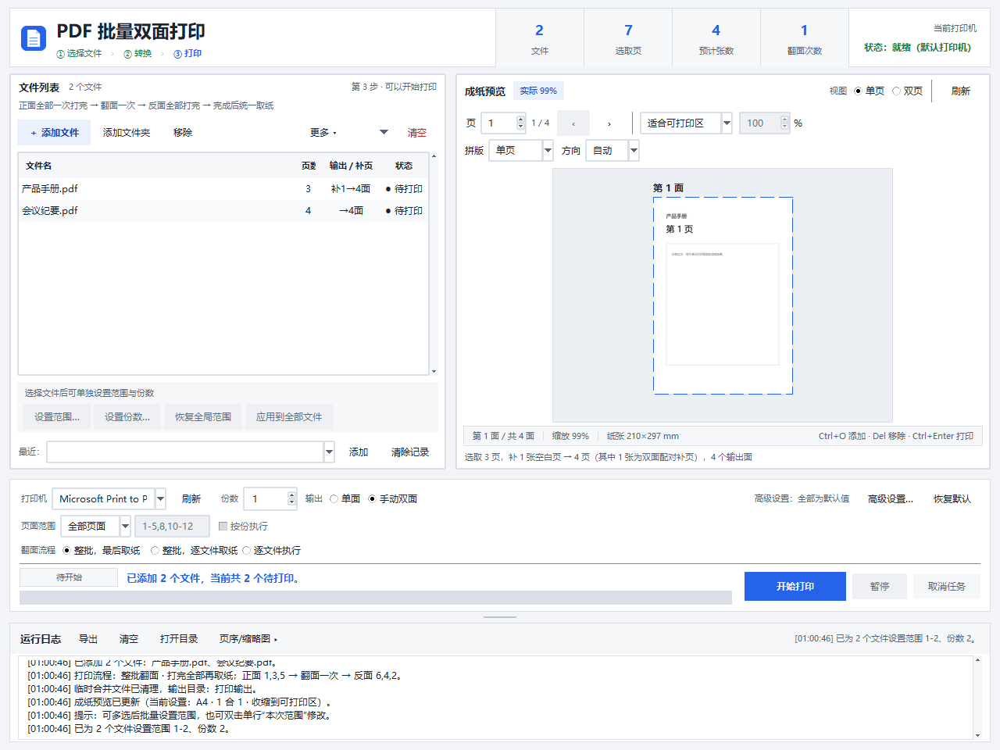

# PDF 批量手动双面打印

Windows 平台的 PDF 批量打印工具：用**普通单面打印机**实现**手动双面打印**，批量导入、自动补空白页、逐面提示翻纸，全程可选、可预览、可取消。

当前版本：**1.1.0**（2026-11-22） · [更新日志](CHANGELOG.md)

默认界面使用 pywebview + WebView2，文件/文件夹选择使用 Windows 原生对话框；Tk 入口保留用于兼容与诊断。



## 为什么需要它

很多办公打印机不支持自动双面，手动双面又容易出错：正面打完忘记翻面、纸张进纸方向不一致、总页数是奇数导致最后一张背面空白却错位。本工具把这一整套容易出错的流程固化成一条固定规则，用户只需要在两批之间把整叠纸翻一次面。

## 核心规则（不可更改的约定）

1. **相对页码**：以用户选定的打印范围为基准重新编号。例如打印 `3-7`，则第 3 页是"相对第 1 页"，第 1、3、5 相对页走第一面。
2. **手动双面顺序**：
   - 第一面：按相对页码**正序**打印**奇数页**（1、3、5…）；
   - 弹出提示，用户把整叠纸取出、**整体翻面**后放回；
   - 第二面：按**逆序**打印**偶数页**（…、6、4、2），使 p 与 p+1 落在同一张纸的正反面。
3. **奇数补页**：范围总页数为奇数时，末尾自动补 1 张**同尺寸、同方向**的空白页，保证每张纸都有正反两面，避免最后一张单面输出。

批量场景下，正反面顺序按**全局页序**计算（而不是逐文件各自倒序），这样多份文件一次打完时纸叠顺序不会乱。

## 功能

- **批量导入**：PDF、Word（`.doc`/`.docx`）、WPS、常见图片格式（自动转成临时 PDF）
- **拖拽添加**：支持从资源管理器拖入文件，自动去重、非支持类型提示；无 tkinterdnd2 时回退到 Win32 `WM_DROPFILES`；也可用"添加文件夹"整目录导入；拖入高亮单层显示——空状态为实线蓝框 + 浅蓝底，有文件时为文件列表内描边，不叠加第二圈虚线
- **选择与批量操作**：添加文件、拖拽或文件夹导入后新增项默认全部选中；转换完成只替换记录、不清空选中；选中操作条四个按钮（范围…/份数…/恢复全局/应用到全部）等宽铺满、固定单横排，1024 逻辑宽度不换行、不截字；文件行单击只切换预览、不改变选中，复选框才切换选中；文件设置弹窗提供“当前文件/已选 N 个/全部文件”应用对象，默认只改当前文件，标题显示“将应用到…”
- **文件操作**：更多菜单的“上移/下移/在资源管理器显示”按当前预览文件执行，不再操作整堆已选；上移/下移成功、首尾边界与资源管理器定位均有明确日志；去重无重复时提示“未发现重复文件”
- **空状态引导**：圆形加号 30×30、白色 stroke 3.4，点击直接打开原生添加对话框；hover/active 仅改变背景与阴影、不做缩放，边缘进出不抖动；1024×680 下自动隐藏空选择栏并压缩空状态，加号完整可见（可见交集 100%）且中心可点
- **打印控制**：打印机选择、页码范围（`1-5,8,10-12`）、份数、逐份/逐页、输出方式（“手动双面”默认且前置、“单面”）；范围控件以“全部/各文件独立/仅奇数页/仅偶数页/当前页”作只读说明，指定范围/上次范围才显示实际文本，全局范围仅作用于未单独设置的文件；范围列只回显实际有效页（1 页文件显示“全部”，长范围收敛为“奇数页”），全局存在逐文件设置时提示“各文件独立”；翻面流程严格按界面三选一执行——“整批，最后取纸”/“整批，逐文件取纸”/“逐文件执行”，不再因文件行残留旧份数静默改写为逐文件流程；整批两档统一使用全局份数，只有“逐文件执行”才采用文件级份数与逐文件设置
- **单面模式**：独立生成单面计划，奇数页文件不再误报“每个文件的面数都必须先补为偶数”，按实际页数直接输出
- **版式**：纸张与进纸盒、方向、缩放（适合可打印区/实际大小/百分比）、N-up 拼版、小册子、页边距、裁切；方向定义为竖版纸高>宽、横版纸宽>高，`auto` 跟随所选范围首页纸向，小册子 `auto` 强制横版，逐文件混向按各自纸面排版；纸张方向仅“自动/竖版/横版”。单页与 N-up 拼版新默认 `auto_rotate=False`，均保持内容阅读方向；高级设置提供 checkbox“方向不符时旋转 90° 适配槽位（默认关闭）”，仅在用户显式开启后为适配槽位旋转。`auto_rotate_choice_version=1` 对旧配置执行一次性迁移，用户显式保存的 `auto_rotate=True` 保持不变
- **可视化预览**：合成"成纸"效果实时预览，正反面方块示意图（第一面正序、第二面逆序），补页单独标注，批量列表显示页数与补页；预览与合成输出逐像素一致（36/36 样本）；横版 4/9/16 新增验收中，14/14 预览与独立渲染逐像素一致
- **完成判定**：打印队列监听（推荐，精确）或固定延时（兼容虚拟打印机/PDF 输出）；队列任务已确认离开队列、且打印机仅剩“等待中/缺纸”这类驱动粘滞位时，按完成处理并记录“任务 #N 已从队列消失，按完成处理”（HP P1007 实测出队后 status 仍为 8208 = WAITING|PAPER_OUT），不阻断后续阶段；真正 ERROR/OFFLINE、任务仍在队列或 EnumJobs 不可用时仍报错或交给用户裁决
- **健壮性**：加密/损坏 PDF 识别、页数越界、取消与暂停、队列超时兜底、临时文件清理（含崩溃残留）；打印状态待确认弹窗先写错误级日志（含阶段与原因）再弹出，标题统一为“打印状态待确认”，日志可直接复盘弹窗来源；`/Rotate` 90/180/270 先烘焙旋转再裁切，贴边内容不丢失；打印机失败统一“脱机”并输出可操作中文日志；单文件范围无效仅该行标红“范围无效”、开始打印禁用，其它行正常刷新，修正后自动恢复；设置范围先校验、非法拒绝且批量原子不写入；主按钮禁用态统一灰底灰字
- **其他**：设置持久化、窗口位置/尺寸记忆（多屏断开自动回退）、最近文件、日志落盘（`%APPDATA%\PDFDuplexPrint\logs\`）、高 DPI 适配、拖拽与快捷键

## 运行环境

- Windows 10 / 11（x64）
- Python 3.10+
- 打印通过 Win32 GDI（依赖 pywin32），**不依赖** Adobe Reader 等外部阅读器
- Word/WPS 转换需要本机安装对应软件（无对应软件时仍可正常处理 PDF 与图片）

## 安装与运行

```bat
run.bat
```

启动器会自动检测并复用环境，顺序为：已保存的环境、项目目录 `.venv`、
`%LOCALAPPDATA%\PDFDuplexPrint\venv`、`%USERPROFILE%\.venvs\PDFDuplexPrint`
和 `%USERPROFILE%\Envs\PDFDuplexPrint`。找到后不会重复创建或安装新的 Python。
如果都不存在，才会在项目目录创建 `.venv`，并把路径保存到本地
`.pdf-duplex-env`（不会提交到 Git）。

也可以显式指定环境，或重置后让启动器重新自动检测：

```bat
run.bat "D:\PythonEnvs\PDFDuplexPrint"
run.bat --reset-env
```

如果需要指定创建 venv 所用的基础 Python，可设置 `PDF_DUPLEX_PYTHON` 环境变量。
Python 3.10+ 必须已安装；程序不会自动在其他磁盘安装 Python。

也可以从 [Releases](https://github.com/shenchuhannb/pdf-duplex-print/releases) 下载打包版，解压后双击 `PDFDuplexPrint.exe`，无需安装 Python；如果发布页暂时没有资产，可按下一节自行打包。请保留同目录的 `_internal` 文件夹。

## 打包为免安装 EXE

```bat
.venv\Scripts\python.exe -m pip install -r requirements-build.txt
tools\build_exe.bat ".venv"
```

产物位于 `dist\PDFDuplexPrint\`，整个目录可拷贝分发。构建脚本会嵌入版本信息、自动执行冻结自检并生成 `SHA256SUMS.txt`。第三方许可证说明见 `THIRD_PARTY_NOTICES.md`。

## 测试

```bat
.venv\Scripts\python.exe -m pip install -r requirements-dev.txt
.venv\Scripts\python.exe -m pytest tests -q
```

覆盖页序推导、补页规则、范围解析、DEVMODE 强制单面、设置迁移与日志初始化等纯逻辑；其中“正反面配对”会遍历所有份数与逐份组合，断言每张纸的反面页码恒等于正面页码 + 1。当前基线为 **320 passed**；真实窗口 `WV_SELFTEST`（1024×680）**87 项全 true**，覆盖更多菜单按当前预览文件上移/下移/定位与日志、去重无重复提示、范围列仅显示有效页、文件设置应用对象（当前/已选/全部，默认当前）、全局“各文件独立”、单文件范围无效隔离与打印禁用、主按钮灰底灰字禁用态、整批流程严格跟随界面选择（不因文件残留旧份数静默改为逐文件、整批用全局份数、仅“逐文件执行”用文件份数）、启动日志“执行流程：…（与界面选择一致）”、队列任务离队后仅剩 WAITING/PAPER_OUT 粘滞位按完成处理、状态待确认弹窗前先写日志，以及拖入单层高亮、行点击仅预览、范围只读说明、方向三选项、单页与拼版默认保持阅读方向、横版 4/9/16 默认方向修复、`auto_rotate_choice_version=1` 旧配置迁移、应用内确认框、四按钮等宽、手动双面前置、脱机文案、横竖版定义、DEVMODE、旋转烘焙与逐文件混向等。横版 4/9/16 默认验收合计 **48 个非空槽**文字水平、页序正确且无越界，**14/14** 预览与独立渲染逐像素一致；显式 `auto_rotate=True` 的旋转记录为 **`[0, -1]`**。第三轮 F1 空状态验收项复验 **PASS**（截图 `docs/screenshots/round3_empty_1024_fixed.png`）。另附 WebView 文件导入、真实窗口布局/图标自检、窗口几何的解析/可见回退/保存换算单测、审计探针与真实 Word 隐藏转换验证。窗口移动/缩放/关闭/重启的实际坐标恢复由 `tools\verify_window_geometry.py` 在隔离 APPDATA 下验证（不执行真实打印）。

## 启动自检

```bat
.venv\Scripts\python.exe pdf_duplex_print.py --self-check
```

输出 `ok=True` 表示依赖、图标与 AppUserModelID 均正常。

## 项目结构

| 文件 | 职责 |
|---|---|
| `webapp/main.py` | 默认 pywebview/WebView2 入口与静态资源路由 |
| `webapp/bridge.py` | 前端桥接、原生文件选择、转换及打印任务编排 |
| `webapp/static/` | 默认界面的 HTML、CSS 与交互脚本 |
| `pdf_duplex_print.py` | Tk 兼容入口：参数解析、依赖检查、DPI 与图标初始化、隐藏自检 |
| `pdf_layout.py` | 页序推导、奇数补页、N-up/小册子拼版与预览几何 |
| `printer_core.py` | GDI 打印后端、DEVMODE、打印机状态与打印队列监听 |
| `settings_store.py` | 设置读写与旧配置迁移、最近文件、Acrobat 默认值 |
| `core_utils.py` | 自定义异常、页码范围解析、拖拽数据解析与单位换算 |
| `word_convert.py` | Word/WPS → 临时 PDF（COM，子进程超时保护） |
| `image_convert.py` | 图片 → 临时 PDF |
| `log_setup.py` | 应用日志与滚动落盘（`%APPDATA%\PDFDuplexPrint\logs`） |
| `app_identity.py` | AppUserModelID、窗口/任务栏图标与进程分组 |
| `theme.py` | 颜色、字体、ttk 样式与尺寸常量 |
| `window_geometry.py` | 窗口居中、位置/尺寸记忆、DPI 物理/逻辑像素换算与多屏可见性修正 |
| `win32_flicker.py` | 顶层窗口背景擦除，消除从后台还原时的黑色方块 |
| `ui_main.py` | 主窗口骨架（mixin 组合）、响应式布局与快捷键 |
| `ui_files.py` | 文件列表、导入/拖拽、最近使用与批次统计 |
| `ui_settings.py` | 打印机、纸张、版式、缩放与高级设置面板 |
| `ui_preview.py` | 成纸预览、页序示意、缩放与翻页 |
| `ui_log.py` | 运行日志面板、分隔条拖动与日志导出 |
| `ui_worker.py` | 打印线程、进度与取消、翻面提示与队列等待 |
| `ui_helpers.py` | 界面共享常量：间距、标签映射、预览限制与布局枚举 |
| `run.bat` | 启动器：检测/复用 Python 环境并启动程序 |
| `requirements.txt` / `requirements-dev.txt` | 运行依赖 / 测试与开发依赖 |
| `app_icon.ico` | 应用、窗口、任务栏与快捷方式的统一图标 |
| `CHANGELOG.md` | 版本更新、测试基线与已知问题 |
| `README.md` | 功能、运行、打包与使用说明 |
| `.gitignore` | 虚拟环境、缓存、打包产物与个人文档的忽略规则 |
| `tests/` | 页序、补页、范围解析、DEVMODE、设置迁移、日志与 UI 几何回归 |
| `tools/` | 图标生成、离屏截图、快捷方式、打包与身份校验脚本 |
| `docs/word_compare/` | Word 打印链路对比实测（乱码率、速度）与可复现脚本 |
| `docs/` | 项目交接、日志拖动分析与界面截图 |

## 文档

- `CHANGELOG.md`：版本更新记录、已知问题与升级说明
- `docs/ROUND3_REPORT.md`：第三轮反馈修复明细与验证数据（默认选中、四按钮单横排、单面奇数页、横版/N-up 纸面与槽位、圆形加号、1024×680 空状态）
- `docs/ROUND4_REPORT.md`：第四轮 UI/交互修复（应用内确认框、等宽按钮、范围联动、脱机文案）与验证
- `docs/screenshots/round4_*.png`：1024×680 实拍（空状态、选中条、范围联动、应用内确认框）
- `docs/screenshots/round5_*.png`：第四轮补充实拍（拖入单层高亮、行点击、范围文案、`nup=1` 不旋转）
- `docs/screenshots/round6_*.png`：第五轮实拍（更多菜单、范围收敛、应用对象）
- `docs/screenshots/round7_range_error_1024.png`：单文件范围无效与开始打印禁用态
- `docs/word_compare/report.md`：本工具链路与"Word 手动转 PDF 再打印"的实测对比（10 份文档 / 59 页）
- `docs/LOG_DRAG_SYMPTOM_ANALYSIS.md`：日志分隔条拖动残影的现象、根因分析与可选方案
- `tools/README.md`：图标生成、截图、快捷方式、身份校验脚本说明

## 已知限制

- 仅支持 Windows（依赖 GDI 与 spooler）
- 手动双面需要人工翻面一次；打印过程中请勿改变纸张方向或取出中间纸叠
- 虚拟打印机（如 Microsoft Print to PDF）无法监听真实出纸，建议改用固定延时判定
- 日志分隔条拖动已采用整帧同步重绘，避免子窗口新旧像素混杂；真实前台快速拖动的观感仍以本机验证为准，详见 `docs/LOG_DRAG_SYMPTOM_ANALYSIS.md`
