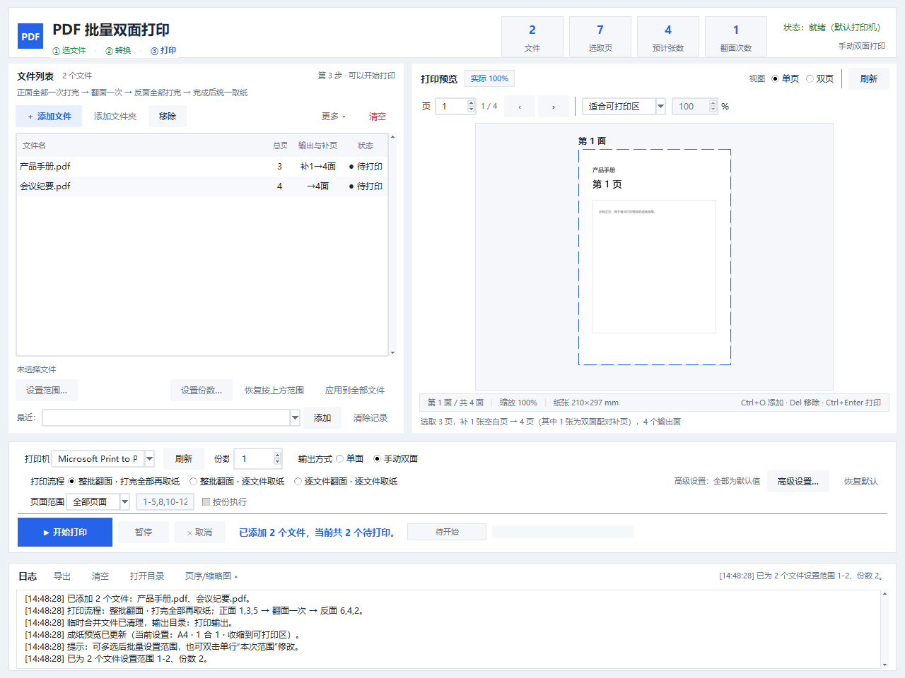

# PDF 批量手动双面打印

Windows 平台的 PDF 批量打印工具：用**普通单面打印机**实现**手动双面打印**，批量导入、自动补空白页、逐面提示翻纸，全程可选、可预览、可取消。



## 为什么需要它

很多办公打印机不支持自动双面，手动双面又容易出错：正面打完忘记翻面、纸张进纸方向不一致、总页数是奇数导致最后一张背面空白却错位。本工具把这一整套容易出错的流程固化成一条固定规则，用户只需要在两批之间把整叠纸翻一次面。

## 核心规则（不可更改的约定）

1. **相对页码**：以用户选定的打印范围为基准重新编号。例如打印 `3-7`，则第 3 页是"相对第 1 页"，第 1、3、5 相对页走第一面。
2. **手动双面顺序**：
   - 第一面：按相对页码**正序**打印**奇数页**（1、3、5…）；
   - 弹出提示，用户把整叠纸取出、**整体翻面**后放回；
   - 第二面：按**逆序**打印**偶数页**（…、6、4、2），使 p 与 p+1 落在同一张纸的正反面。
3. **奇数补页**：范围总页数为奇数时，末尾自动补 1 张**同尺寸、同方向**的空白页，保证每张纸都有正反两面，避免最后一张单面输出。

批量场景下，正反面顺序按**全局页序**计算（而不是逐文件各自倒序），这样多份文件一次打完时纸叠顺序不会乱。

## 功能

- **批量导入**：PDF、Word（`.doc`/`.docx`）、WPS、常见图片格式（自动转成临时 PDF）
- **拖拽添加**：支持从资源管理器拖入文件，自动去重、非支持类型提示；无 tkinterdnd2 时回退到 Win32 `WM_DROPFILES`；也可用"添加文件夹"整目录导入
- **打印控制**：打印机选择、页码范围（`1-5,8,10-12`）、份数、逐份/逐页、手动双面、单面
- **版式**：纸张与进纸盒、方向、缩放（适合可打印区/实际大小/百分比）、N-up 拼版、小册子、页边距、裁切
- **可视化预览**：合成"成纸"效果实时预览，正反面方块示意图（第一面正序、第二面逆序），补页单独标注，批量列表显示页数与补页
- **完成判定**：打印队列监听（推荐，精确）或固定延时（兼容虚拟打印机/PDF 输出）
- **健壮性**：加密/损坏 PDF 识别、页数越界、取消与暂停、队列超时兜底、临时文件清理（含崩溃残留）
- **其他**：设置持久化、最近文件、日志落盘（`%APPDATA%\PDFDuplexPrint\logs\`）、高 DPI 适配、拖拽与快捷键

## 运行环境

- Windows 10 / 11（x64）
- Python 3.10+
- 打印通过 Win32 GDI（依赖 pywin32），**不依赖** Adobe Reader 等外部阅读器
- Word/WPS 转换需要本机安装对应软件（无对应软件时仍可正常处理 PDF 与图片）

## 安装与运行

```bat
python -m venv .venv
.venv\Scripts\python.exe -m pip install -r requirements.txt
run.bat
```

也可以直接下载 Releases 里的打包版，双击 `PDF双面打印.exe`，无需安装 Python。

## 打包为免安装 EXE

```bat
.venv\Scripts\python.exe -m pip install pyinstaller
tools\build_exe.bat
```

产物位于 `dist\PDF双面打印\`，整个目录可拷贝分发。

## 测试

```bat
.venv\Scripts\python.exe -m pip install -r requirements-dev.txt
.venv\Scripts\python.exe -m pytest tests -q
```

覆盖页序推导、补页规则、范围解析、DEVMODE 强制单面、设置迁移与日志初始化等纯逻辑；其中"正反面配对"会遍历所有份数与逐份组合，断言每张纸的反面页码恒等于正面页码 + 1。

## 启动自检

```bat
.venv\Scripts\python.exe pdf_duplex_print.py --self-check
```

输出 `ok=True` 表示依赖、图标与 AppUserModelID 均正常。

## 项目结构

| 文件 | 职责 |
|---|---|
| `pdf_duplex_print.py` | 入口：参数解析、自检、DPI 与图标初始化 |
| `pdf_layout.py` | 页序推导、补页、N-up/小册子拼版、预览几何 |
| `printer_core.py` | GDI 打印后端、DEVMODE、打印机状态、队列监听 |
| `word_convert.py` | Word/WPS → 临时 PDF（COM，子进程超时保护） |
| `image_convert.py` | 图片 → 临时 PDF |
| `ui_main.py` | 主窗口骨架（mixin 组合） |
| `ui_files.py` / `ui_settings.py` / `ui_preview.py` / `ui_log.py` / `ui_worker.py` | 各面板与打印线程 |
| `settings_store.py` | 设置持久化与迁移 |
| `core_utils.py` | 异常类型、范围解析、拖拽数据解析、单位换算 |
| `docs/word_compare/` | Word 打印链路对比实测（乱码率、速度）与可复现脚本 |

## 文档

- `docs/word_compare/report.md`：本工具链路与"Word 手动转 PDF 再打印"的实测对比（10 份文档 / 59 页）
- `tools/README.md`：图标生成、截图、快捷方式、身份校验脚本说明

## 已知限制

- 仅支持 Windows（依赖 GDI 与 spooler）
- 手动双面需要人工翻面一次；打印过程中请勿改变纸张方向或取出中间纸叠
- 虚拟打印机（如 Microsoft Print to PDF）无法监听真实出纸，建议改用固定延时判定
