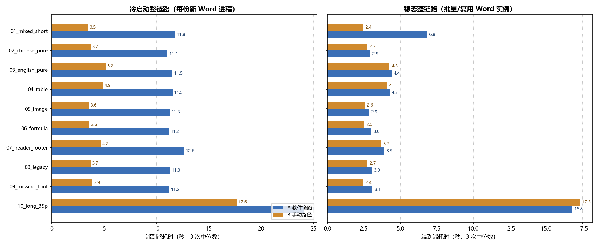
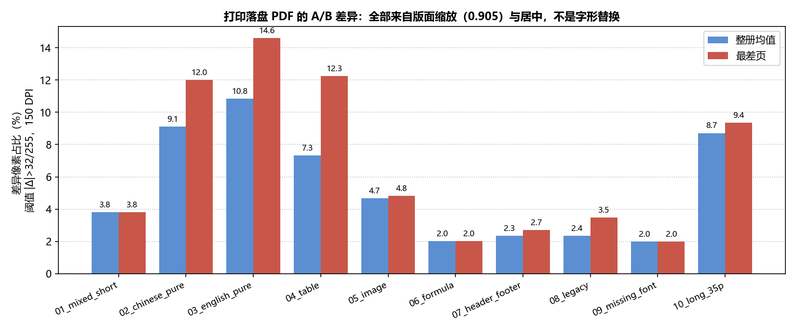

# Word 打印对比实测：本软件链路 vs 手动“Word 转 PDF 再打印”

测试日期：2026-11-04　测试机：x64 8 核 / 32 GB RAM / Windows 11
Word：Microsoft Office 家庭和学生版 2021 x64，16.0.20527.20112
打印驱动：Microsoft Print to PDF（两条路径同一驱动）；打印分辨率 300 DPI，落盘 PDF 为 A4。

## 一、结论（先给数字）

### 1. 乱码率：差 0，且是“完全相同”而不是“统计上不显著”

| 指标 | A 软件链路 | B 手动路径 | 差值 |
|---|---|---|---|
| U+FFFD 替换字符 | 0 个 | 0 个 | 0 |
| 方框/缺字字符（■□▯⬜◾） | 0 个 | 0 个 | 0 |
| 缺失 glyph 次数 | 0 / 67,840 次检查 | 0 / 67,840 次检查 | 0 |
| 字符缺失率 | 10 份中 9 份 0.00%；05 为 1.61%（源文本导出伪差，见 4.3） | 与 A 完全相同 | 0 |
| 未嵌入字体 | 0 个 | 0 个 | 0 |
| 字体替换 | 仅 09（Cambria，Word 自身回退） | 仅 09（Cambria，同名字体） | 0 |
| 转换产物逐页像素差 | — | — | **59/59 页均为 0.000%** |

- 10 份文档、59 页，A 的转换产物与 Word 默认导出的 PDF **逐页逐像素相同**（150 DPI 灰度，阈值 |Δ|>32/255），文本层 67,840 个字符完全一致，字体清单与嵌入状态完全一致。
- 两份 PDF 的字节并不相同（CreationDate/ID 等元数据不同），但**内容层没有差异**；因此“乱码率差 0”是可复核的测量结果，不是“看起来没问题”。
- 打印落盘后的 PDF 是**纯栅格图像**（文本 0 字符、字体对象 0 个），文本层指标在打印产物上不适用；打印件只能做像素比较与目检（见 4.4）。

### 2. 速度：冷启动差 2.35 倍（显著）；稳态批量只差 14%，剔除首份后 5%（不显著）

| 场景 | A 软件链路 | B 手动路径（脚本等价） | 差值 | 判定 |
|---|---|---|---|---|
| **冷启动整链路**（每份新进程/新 Word） | 127.19 s / 10 份 | 54.16 s / 10 份 | **+73.03 s，2.35 倍**；逐文件中位 **2.93 倍**（1.34–3.35 倍） | **显著** |
| 其中：仅 Word→PDF 转换 | 90.27 s（中位 8.63 s/份） | 18.73 s（中位 1.45 s/份） | **+71.54 s，4.82 倍**；逐文件中位 **5.75 倍**（2.66–6.41 倍） | **显著** |
| **稳态整链路**（批量复用 Word） | 51.19 s / 10 份 | 44.76 s / 10 份 | **+6.43 s，1.14 倍**；逐文件中位 1.10 倍（0.98–2.78 倍） | **不显著** |
| 稳态但剔除首份（批量启动开销） | 44.37 s / 9 份 | 42.31 s / 9 份 | **+2.06 s，1.05 倍** | **不显著** |
| 其中：仅提交打印（含落盘） | 36.99 s | 35.53 s | +1.46 s，**1.04 倍** | **不显著** |
| 35 页长文档稳态 | 16.87 s | 17.30 s | **0.98 倍（A 略快）** | — |

一句话回答用户：

- **乱码**：本软件打印 Word 与“手动转 PDF 再打印”在乱码指标上**没有差别（0）**，转换产物逐页像素完全相同。
- **速度**：**单文件/冷启动**本软件慢约 **2.9 倍/份**（整链路 2.35 倍；只算转换 4.82 倍），**显著**；**批量/稳态**整链路只慢 **14%**，剔除批量首份后只慢 **5%**，长文档甚至略快（0.98 倍），**不显著**。

> 上表总耗时包含两条路径相同的“落盘稳定轮询”约 1.0 s/份（测量实现固定轮询窗口）。扣除这 10 s 固定开销后：冷启动 117.19 s vs 44.16 s（**2.65 倍**），稳态 41.18 s vs 34.75 s（**1.18 倍**），结论方向不变。

## 二、两条对照路径（实际执行的链路）

### A：软件链路

1. `word_convert.convert_file(src, dst)`：独立子进程 → Word COM `ExportAsFixedFormat`；转换前后执行进程枚举/清理。
2. `word_convert.convert_batch([...])`：单子进程内复用 Word 实例批量导出（稳态场景）。
3. `pdf_layout.compose_layout_pdf(src_pdf, pages, out_pdf, LayoutOptions())`：默认页边距 10/10/10/8 mm，等比缩放 **0.905** 并居中；奇数页补 1 页空白用于双面对齐。
4. `printer_core.GdiPrinter(...).print_pages(layout_pdf, ...)`：PyMuPDF 300 DPI 栅格化 → `StretchDIBits` → `StartPage/EndPage/EndDoc`，DEVMODE 单面/单份/一页一版。

为把打印结果落盘，测量进程在**运行时**给 `printer_core._gdi32.StartDocW` 打补丁，把 `DOCINFOW.lpszOutput` 指向目标 PDF；**业务代码一行未改**。

### B：手动路径（脚本等价）

1. Word COM `ExportAsFixedFormat(OutputFileName=..., ExportFormat=17, OpenAfterExport=False)`，即“另存为 PDF”默认参数。
2. 用 PyMuPDF 打开 PDF 并读页数，等价于“打开 PDF”（不含阅读器 GUI 启动）。
3. 自写独立 GDI 打印：同一 `Microsoft Print to PDF`、同一 300 DPI、同一可打印区、同样通过 `DOCINFO.lpszOutput` 落盘。

B 路径**未计入**人工点击、Word/PDF 阅读器 GUI 启动、另存为对话框操作时间；因此 B 的耗时是“脚本等价下限”，真实人工操作只会更慢（见“未验证项”）。

## 三、样本构建与筛选（不挑样本）

10 份样本在正式测量前一次性生成，全部进入两条路径与 3 次重复；测量阶段未替换/删除任何样本。详见 [samples.md](samples.md) 与 `samples/`。

| # | 文件 | 页数 | 内容/字号 | 覆盖点 |
|---|---|---|---|---|
| 01 | 01_mixed_short.docx | 1 | 中英混排，10.5/11/12/16pt | 中英混排、短文档 |
| 02 | 02_chinese_pure.docx | 2 | 纯中文，宋体/黑体/楷体 12pt | 纯中文 |
| 03 | 03_english_pure.docx | 6 | 纯英文，Calibri/Times/Arial 10–12pt | 纯英文 |
| 04 | 04_table.docx | 4 | 12×5、8×4 表格，9pt | 表格 |
| 05 | 05_image.docx | 2 | 12cm×7cm PNG 图表 + 图注 | 图片 |
| 06 | 06_formula.docx | 1 | OMML 公式 + 特殊符号，Cambria Math 13–14pt | 公式/符号 |
| 07 | 07_header_footer.docx | 5 | 页眉/页脚/页码域，11pt | 页眉页脚页码 |
| 08 | 08_legacy.doc | 2 | 旧二进制 `.doc` | 旧格式 |
| 09 | 09_missing_font.docx | 1 | 强制声明 `NoSuchFontABC`，12/14pt | 缺失字体 |
| 10 | 10_long_35p.docx | 35 | 长文档，10.5–12pt | 30 页以上 |

筛选标准：先列需求覆盖矩阵，每类至少 1 份；页数覆盖 1/2/4/5/6/35；全部纳入统计。09 的缺失字体通过改写 OOXML `rFonts` 注入（Word 输入时会静默替换不存在的字体）。07 首次生成的页脚域顺序写错，正式测量前修正并重测，其余 9 份未修改。

## 四、乱码量化方法与结果

### 4.1 文本层

- 提取 PDF 全文，去掉空白后与 Word 导出的正文文本比较。
- 统计 U+FFFD、方框候选字符；用 `difflib.SequenceMatcher` 比率与字符多重集缺失率衡量字符缺失。
- 逐 span 用 `fitz.Font(...).has_glyph()` 检查每个字符是否真的能在嵌入字体里找到 glyph。

### 4.2 字体层

- 逐页 `page.get_fonts()` 判断是否嵌入；字体名去掉 `ABCDEF+` 子集前缀与 Bold/Italic/PSMT 等样式后缀。
- 声明字体来自 `.docx` 的 `document.xml/styles.xml/header*/footer*.xml` 的 `rFonts`；`.doc` 用 Word 逐字符抽样。
- 与 PDF 实际字体比对，列出替换字体。

### 4.3 结果（表 1）

| 样本 | 页数 | 字号 / 声明字体 | A 字符 / B 字符 | U+FFFD（A/B） | 方框字符（A/B） | 字符缺失率（A/B） | 缺失 glyph（A/B） | 未嵌入字体（A/B） | 替换字体（A/B） | 转换像素差（均值/最差） | 打印像素差（均值/最差） |
|---|---|---|---|---|---|---|---|---|---|---|---|
| 01_mixed_short | 1 | 中英混排 10.5/11/12/16pt；Times New Roman、宋体、微软雅黑 | 314 / 314 | 0 / 0 | 0 / 0 | 0.00% / 0.00% | 0/314 / 0/314 | 0 / 0 | 无 / 无 | 0.00% / 0.00% | 3.81% / 3.81% |
| 02_chinese_pure | 2 | 纯中文 宋体/黑体/楷体 12pt；Times New Roman、宋体、楷体、黑体 | 1380 / 1380 | 0 / 0 | 0 / 0 | 0.00% / 0.00% | 0/1380 / 0/1380 | 0 / 0 | 无 / 无 | 0.00% / 0.00% | 9.11% / 12.01% |
| 03_english_pure | 6 | 纯英文 Calibri/Times/Arial 10–12pt；Arial、Calibri、Times New Roman、宋体 | 11737 / 11737 | 0 / 0 | 0 / 0 | 0.00% / 0.00% | 0/11737 / 0/11737 | 0 / 0 | 无 / 无 | 0.00% / 0.00% | 10.85% / 14.60% |
| 04_table | 4 | 表格 9pt；Calibri、Times New Roman、宋体、微软雅黑 | 3693 / 3693 | 0 / 0 | 0 / 0 | 0.00% / 0.00% | 0/3693 / 0/3693 | 0 / 0 | 无 / 无 | 0.00% / 0.00% | 7.34% / 12.25% |
| 05_image | 2 | 图片；Times New Roman、宋体、微软雅黑 | 122 / 122 | 0 / 0 | 0 / 0 | 1.61% / 1.61% | 0/122 / 0/122 | 0 / 0 | 无 / 无 | 0.00% / 0.00% | 4.67% / 4.83% |
| 06_formula | 1 | 公式 Cambria Math 13–14pt；Cambria Math、Times New Roman、宋体、微软雅黑 | 162 / 162 | 0 / 0 | 0 / 0 | 0.00% / 0.00% | 0/162 / 0/162 | 0 / 0 | 无 / 无 | 0.00% / 0.00% | 2.02% / 2.02% |
| 07_header_footer | 5 | 页眉页脚页码 11pt；Times New Roman、宋体、微软雅黑 | 1133 / 1133 | 0 / 0 | 0 / 0 | 0.00% / 0.00% | 0/1133 / 0/1133 | 0 / 0 | 无 / 无 | 0.00% / 0.00% | 2.34% / 2.70% |
| 08_legacy | 2 | 旧 `.doc`；Times New Roman、宋体、黑体 | 508 / 508 | 0 / 0 | 0 / 0 | 0.00% / 0.00% | 0/508 / 0/508 | 0 / 0 | 无 / 无 | 0.00% / 0.00% | 2.36% / 3.47% |
| 09_missing_font | 1 | 缺失字体 12/14pt；NoSuchFontABC、Times New Roman、宋体 | 156 / 156 | 0 / 0 | 0 / 0 | 0.00% / 0.00% | 0/156 / 0/156 | 0 / 0 | Cambria-Bold、Cambria / 同名同数量 | 0.00% / 0.00% | 1.99% / 1.99% |
| 10_long_35p | 35 | 长文档 10.5–12pt；Times New Roman、宋体、微软雅黑、黑体 | 48635 / 48635 | 0 / 0 | 0 / 0 | 0.00% / 0.00% | 0/48635 / 0/48635 | 0 / 0 | 无 / 无 | 0.00% / 0.00% | 8.71% / 9.35% |

说明：

- **05 的 1.61% 字符缺失率不是乱码**。Word 的 `Content.Text` 会把内嵌图片以 `/` 占位符导出，源文本比 PDF 实际文字多 2 个 `/`；A/B 完全同值，PDF 内无 U+FFFD、无缺失 glyph。
- **09 的 Cambria 替换不是软件链路造成的**：`NoSuchFontABC` 在本机不存在，Word 自己在导出 PDF 时就回退到 Cambria；A 和 B 得到同一组替换字体、同一像素结果。这也说明“缺失字体文档”在本机不会产生方框，只会按 Word 规则回退。
- 字体嵌入：两路径所有字体均嵌入（未嵌入数 0/0），不存在“PDF 依赖打印端字体”的情况。
- 机制上也可解释：A 的转换内部同样调用 Word COM `ExportAsFixedFormat`，与 B 的默认导出是同一个 API；本次参数一致，所以内容层逐页相同。

### 4.4 像素层与人工目检

- 渲染口径：两条路径同一 DPI（150 DPI）、同一灰度色彩空间；逐页计算 `|A-B| > 32/255` 的像素占比。
- 转换产物：**59/59 页 0.000%**，即 A 的转换 PDF 与 Word 默认导出 PDF 在像素层面完全一致（热力图：`heatmaps/conv_*.png`）。
- 打印落盘：A/B 的像素差 **整册均值 1.99%–10.85%，全部页均值 7.65%，单页最大 14.60%**（`heatmaps/print_*.png`）。热力图显示差异集中在文字边缘的**整体位移/缩放**，不是某个字形被替换成方框。
- 原因已实测：A 的排版 PDF 把每页内容等比缩放到 **0.905**（bbox 宽、高比均为 0.905）并居中，B 为 1:1 满幅；例如 01 的 bbox 从 `[90.0,77.1,500.5,331.5]` 变为 `[109.8,112.7,481.1,342.9]`。这是产品版心/边距行为，不是乱码。
- 打印像素差不能等同于乱码率：打印产物是纯图像，字形是否“错”只能靠像素 + 目检。目检 4 份文档 × 2 条路径（04 表格、06 公式、07 页眉页脚页码、09 缺失字体），每份第 1 页并排截图保存在 `shots/`，均未出现方框、缺字或错位；07 的页脚为“第 1 页 / 共 5 页”，09 回退字体后仍可读。
- A 的排版会对奇数页补空白页：01（1→2）、06（1→2）、07（5→6）、09（1→2）、10（35→36）。像素比较只取两条路径的 `min(页数)`，空白页不计入差异；但它会增加 A 的实际打印页数与耗时。

## 五、速度量化方法与结果

### 5.1 口径

- 每项重复 **3 次**，报**中位数与范围**；不取最好成绩。
- 冷启动：A 每份新建子进程/新 Word；B 每份新建 Word 实例。
- 稳态：A 批量在同一子进程复用 Word；B 同一 Word 实例连续导出。
- 总耗时 = 转换 + 排版/打开 + 提交打印 + 落盘稳定等待。渲染耗时单独测量（A 渲染排版后 PDF，含补页；B 渲染导出 PDF），打印内部会再次栅格化，故渲染不重复计入总分。
- 落盘等待对两条路径使用同一实现（文件大小连续稳定），固定约 1.0 s/份，已在上文说明并给出扣除后的数字。
- A 的批量与单文件分别测量；B 的“另存为 PDF + 打开 PDF + 打印”用脚本等价流程，人工点击时间未编造、未计入。

### 5.2 转换与渲染（表 2，秒，3 次中位数（范围））

| 样本 | 页数 | A 单文件转换（冷） | A 批量内单文件（稳态） | B 冷启动导出 | B 稳态导出 | A 渲染 | B 渲染 |
|---|---|---|---|---|---|---|---|
| 01_mixed_short | 1 | 9.12 (8.66–9.31) | 4.16 (2.84–4.16) | 1.45 (1.42–1.48) | 0.41 (0.41–1.60) | 0.04 (0.03–0.04) | 0.04 (0.04–0.05) |
| 02_chinese_pure | 2 | 8.63 (8.00–8.78) | 0.50 (0.47–0.58) | 1.45 (1.25–1.50) | 0.48 (0.47–0.48) | 0.05 (0.05–0.05) | 0.09 (0.08–0.10) |
| 03_english_pure | 6 | 8.04 (7.58–9.16) | 0.93 (0.85–0.96) | 1.69 (1.50–1.81) | 0.79 (0.72–0.81) | 0.12 (0.11–0.14) | 0.23 (0.19–0.24) |
| 04_table | 4 | 8.65 (8.36–9.68) | 1.39 (1.29–1.43) | 2.15 (2.14–2.42) | 1.35 (1.29–1.38) | 0.08 (0.07–0.10) | 0.15 (0.13–0.16) |
| 05_image | 2 | 8.78 (8.60–8.91) | 0.38 (0.35–0.42) | 1.37 (1.35–1.62) | 0.36 (0.34–0.41) | 0.06 (0.05–0.07) | 0.10 (0.08–0.11) |
| 06_formula | 1 | 8.72 (7.49–9.01) | 0.55 (0.48–0.58) | 1.57 (1.54–1.98) | 0.50 (0.45–0.50) | 0.03 (0.02–0.04) | 0.03 (0.03–0.04) |
| 07_header_footer | 5 | 9.29 (8.05–9.30) | 0.56 (0.49–0.56) | 1.49 (1.48–1.55) | 0.51 (0.49–0.57) | 0.08 (0.07–0.08) | 0.14 (0.12–0.14) |
| 08_legacy | 2 | 8.88 (8.66–8.88) | 0.63 (0.59–0.72) | 1.48 (1.47–1.50) | 0.51 (0.46–0.62) | 0.03 (0.03–0.04) | 0.06 (0.06–0.08) |
| 09_missing_font | 1 | 8.85 (8.80–8.85) | 0.74 (0.69–0.74) | 1.83 (1.80–1.85) | 0.38 (0.32–0.70) | 0.03 (0.02–0.04) | 0.03 (0.03–0.04) |
| 10_long_35p | 35 | 11.33 (9.91–11.38) | 4.01 (3.63–4.11) | 4.26 (4.11–5.12) | 3.92 (3.91–3.94) | 0.87 (0.87–0.93) | 1.49 (1.39–1.76) |

A 单文件慢的主因已拆解测量：子进程完整转换 6.92 s，其中 `tasklist` 进程枚举 1.32–2.55 s/次、共 3–4 s；Word 启动 + 打开/导出/关闭约 2.7 s；父进程额外约 0.56 s。批量模式复用 Word 后不再逐份做进程枚举，单份降到 0.38–4.01 s（长文档主要受内容量影响）。

### 5.3 打印与整链路（表 3，秒，3 次中位数（范围））

| 样本 | A 排版 | A 提交打印 | B 打开 PDF | B 提交打印 | 冷启动总耗时 A / B | 冷启动倍数 | 稳态总耗时 A / B | 稳态倍数 |
|---|---|---|---|---|---|---|---|---|
| 01_mixed_short | 0.01 (0.01–0.01) | 2.65 (2.53–2.69) | 0.002 (0.001–0.002) | 2.03 (2.00–2.36) | 11.66 (11.32–12.01) / 3.48 (3.48–3.78) | 3.35x | 6.82 (5.38–6.86) / 2.45 (2.41–3.95) | 2.78x |
| 02_chinese_pure | 0.01 (0.01–0.02) | 2.41 (2.36–2.60) | 0.001 (0.001–0.002) | 2.25 (2.22–2.33) | 11.05 (10.37–11.40) / 3.71 (3.50–3.78) | 2.97x | 3.00 (2.87–3.09) / 2.73 (2.69–2.81) | 1.10x |
| 03_english_pure | 0.03 (0.02–0.03) | 3.44 (3.43–3.66) | 0.001 (0.001–0.002) | 3.47 (3.33–3.67) | 11.72 (11.05–12.61) / 5.15 (4.97–5.36) | 2.28x | 4.40 (4.30–4.64) / 4.28 (4.05–4.46) | 1.03x |
| 04_table | 0.02 (0.02–0.02) | 2.86 (2.70–3.16) | 0.001 (0.001–0.002) | 2.73 (2.46–2.80) | 11.83 (11.09–12.56) / 4.89 (4.60–5.22) | 2.42x | 4.17 (4.11–4.61) / 4.02 (3.81–4.19) | 1.04x |
| 05_image | 0.01 (0.01–0.01) | 2.46 (2.22–2.49) | 0.001 (0.001–0.001) | 2.19 (2.05–2.24) | 11.13 (11.08–11.28) / 3.55 (3.42–3.86) | 3.14x | 2.88 (2.58–2.90) / 2.61 (2.40–2.61) | 1.11x |
| 06_formula | 0.01 (0.01–0.01) | 2.46 (2.34–2.48) | 0.002 (0.001–0.002) | 2.02 (1.95–2.06) | 11.21 (9.83–11.47) / 3.55 (3.52–4.04) | 3.16x | 2.97 (2.92–3.01) / 2.51 (2.45–2.51) | 1.18x |
| 07_header_footer | 0.01 (0.01–0.02) | 3.34 (3.28–3.50) | 0.002 (0.001–0.003) | 3.17 (3.09–3.22) | 12.65 (11.34–12.81) / 4.65 (4.59–4.77) | 2.72x | 3.91 (3.86–4.01) / 3.68 (3.66–3.71) | 1.06x |
| 08_legacy | 0.01 (0.01–0.01) | 2.41 (2.33–2.50) | 0.002 (0.001–0.002) | 2.22 (2.19–2.26) | 11.22 (11.08–11.39) / 3.72 (3.69–3.75) | 3.01x | 3.10 (2.98–3.14) / 2.72 (2.70–2.85) | 1.14x |
| 09_missing_font | 0.01 (0.01–0.01) | 2.34 (2.32–2.46) | 0.001 (0.001–0.001) | 2.06 (2.00–2.09) | 11.20 (11.13–11.32) / 3.89 (3.80–3.94) | 2.88x | 3.07 (3.04–3.21) / 2.47 (2.38–2.70) | 1.25x |
| 10_long_35p | 0.15 (0.14–0.15) | 12.62 (12.00–13.53) | 0.002 (0.001–0.002) | 13.39 (12.44–13.67) | 23.52 (22.67–25.00) / 17.56 (17.50–17.93) | 1.34x | 16.87 (15.78–17.68) / 17.30 (16.38–17.60) | 0.98x |

解读：

- 打印单环节 A 与 B 基本持平（合计 36.99 s vs 35.53 s，1.04 倍）。短文档 A 每份慢 0.2–0.6 s，主要是奇数页补空白页（01/06/09 各多打 1 页）；35 页长文档 A 反而略快（12.62 s vs 13.39 s）。
- 冷启动差异来自转换：A 每份 8–11 s，B 每份 1.4–4.3 s；A 的固定开销（子进程 + `tasklist` 枚举 + Word 启动）占大头，页数只影响内容部分。
- 稳态下批量首份承担 Word 启动与首次枚举开销（01 批量 4.16 s、单份总 6.82 s）；从第二份起 A 与 B 基本持平（剔除首份 1.05 倍）。
- 35 页长文档冷启动也只有 1.34 倍，说明文档越大，A 的固定开销被摊薄。





## 六、证据与产物

| 内容 | 路径 |
|---|---|
| 本报告 | `d:\打印机软件\docs\word_compare\report.md` |
| 样本清单 | `d:\打印机软件\docs\word_compare\samples.md` |
| 样本原文件与正文导出 | `docs\word_compare\samples\`（10 份 `.doc(x)` + `*.source.txt` + `samples.json`） |
| 逐文件表格（可直接复用） | `docs\word_compare\data\tables.md` |
| 原始指标 | `docs\word_compare\data\metrics.json` |
| 转换计时原始值 | `docs\word_compare\data\convert_timing.json` |
| 打印计时原始值 | `docs\word_compare\data\print_timing.json` |
| 环境 | `docs\word_compare\data\env.json` |
| 转换热力图（10 份，全为 0 差异） | `docs\word_compare\heatmaps\conv_*.png` |
| 打印热力图（10 份，最差页） | `docs\word_compare\heatmaps\print_*.png` |
| 人工目检截图（4 份 × 2 路径，第 1 页） | `docs\word_compare\shots\*.png` |
| 速度对比图 / 打印差异图 | `docs\word_compare\speed_total.png`、`docs\word_compare\print_diff.png` |
| 测量与样本脚本 | `docs\word_compare\scripts\` |
| A/B 转换、排版、打印 PDF（大文件） | `%TEMP%\word_print_compare\out\convA|exportB|layoutA|printA|printB\` |

代表性热力图：

- 转换（0 差异）：`docs\word_compare\heatmaps\conv_03_english_pure.png`
- 打印（版面位移）：`docs\word_compare\heatmaps\print_03_english_pure.png`

## 七、复现命令

```powershell
cd %TEMP%\word_print_compare

# 1) 生成 10 份样本（Word COM）
python make_samples.py
python inspect_samples.py          # 记录页数/字号/字体，导出 *.source.txt
python fix_missing_font.py         # 09 注入 NoSuchFontABC
python fix_footer07.py             # 07 页脚域顺序修正

# 2) 两条路径测量（每项 3 次；PRINTER、DPI=300、REPEATS=3 在 measure.py 顶部）
$env:STAGE="all"; python measure.py

# 3) 修正声明字体口径（OOXML rFonts），重算替换字体
python recompute_declared.py
python fix_metrics.py

# 4) 生成热力图、截图、图表与表格
python make_artifacts.py
python make_tables.py
```

关键参数：`PRINTER="Microsoft Print to PDF"`、`DPI=300`、`REPEATS=3`；A 路径调用 `word_convert.convert_file/convert_batch`、`pdf_layout.compose_layout_pdf`（默认 `LayoutOptions`）、`printer_core.GdiPrinter.print_pages`；B 路径调用 Word `ExportAsFixedFormat(ExportFormat=17)` 与独立 GDI 打印。像素比较 150 DPI 灰度、阈值 `|Δ|>32/255`。

## 八、未验证项与局限

1. **无实体打印机**：最终出纸的字形、碳粉/喷墨表现、机械速度均未验证；本文所有打印结论来自 `Microsoft Print to PDF` 虚拟驱动生成的 PDF（纯 300 DPI 栅格图）。虚拟驱动结论**不能等同**真实打印机（真实驱动可能重新做字体替换、半色调、纸张缩放）。
2. **打印件无文本层**：落盘 PDF 文本 0 字符、字体对象 0 个，因此“打印后的乱码率”只能做像素比较与目检，无法像源 PDF 那样统计 U+FFFD/缺失 glyph。
3. **B 路径的人工时间未测**：只测了脚本等价的“导出 → 打开 → 提交打印”，未包含用户点击、对话框、阅读器 GUI 启动；真实手动操作只会更慢，B 的数字是下限。
4. **环境单一**：仅 Word 2021 x64 + 本机一种虚拟驱动；未覆盖 WPS、网络打印机、PostScript/PCL 驱动、不同 Windows 字体版本。
5. **重复次数少**：每项 3 次，只能给中位数与范围，不能做严格显著性检验；B 冷启动 08_legacy 第 3 次 COM 失败，按 2 次成功值统计（失败已记录，未替换样本）。
6. **样本为合成文档**：覆盖了需求类别，但不代表所有真实公文/论文版式；复杂域、宏、嵌入 OLE、竖排/少数民族文字未覆盖。
7. **07 的页脚修正**：首次生成的页码域顺序错误，正式测量前修正并重测；这属于样本构建修正，不影响 A/B 对比方法。
